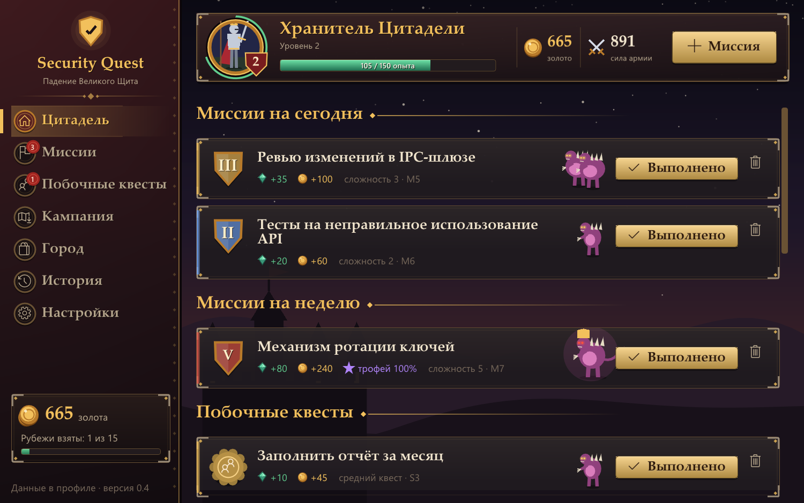
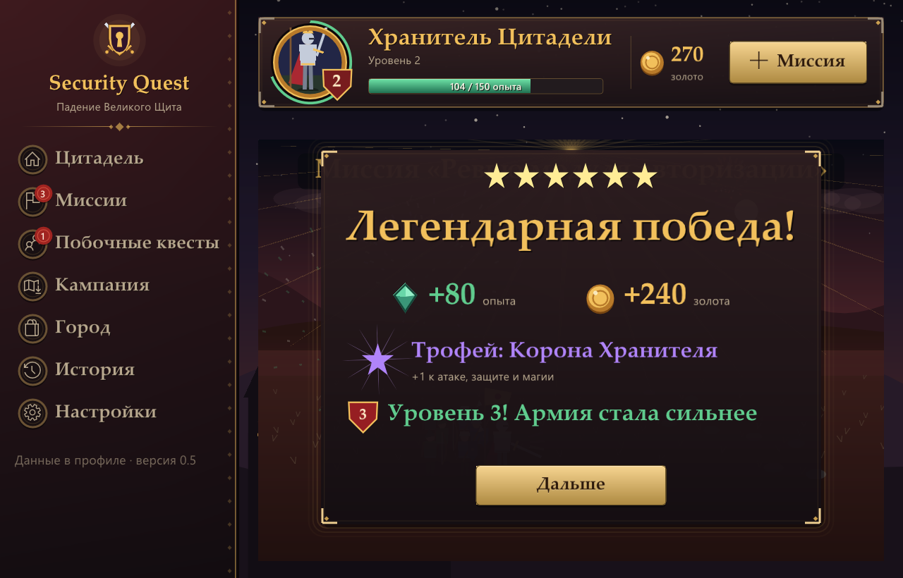

# Security Quest

Портативное приложение под Windows: задачи-миссии и побочные квесты приносят опыт и золото, а на них герой собирает армию для фэнтези-кампании «Падение Великого Щита». Концепция описана в [CONCEPT.md](CONCEPT.md), отложенное — в [IDEAS.md](IDEAS.md).



## Запуск

Портативная версия лежит в `dist\SecurityQuest\`: дважды щёлкните `Security Quest.exe`. Установка не нужна, данные хранятся в папке `data` рядом с программой. Нужна Windows 10 или новее.

Крестик сворачивает окно в трей. Выйти можно через меню значка в трее.

## Окно

| Раздел | Что там |
|---|---|
| Цитадель | Миссии на сегодня и на неделю, побочные квесты, следующий рубеж кампании с требованиями, недавно выполненное |
| Миссии | Создание задачи: название, сложность 1–5, сегодня или неделя, предпросмотр награды. Кнопка «Выполнено», карандаш — изменить задачу |
| Побочные квесты | Лёгкий, средний или сложный; «Уже сделал» или «Запланировать» |
| Кампания | Морская карта глав с туманом, 31 рубеж, требования, враг; бой на шестиугольном поле вручную или автобоем; летопись похода |

Выполненная задача — короткий мультик на 3–5 секунд: армия Хранителя громит тварей, вылезших из разлома, затем победный экран с наградой. Чем сложнее задача, тем больше размах: от трёх бесёнков за лёгкий квест до Исполина Бездны с молниями и салютом за миссию сложности 5. Мультик можно пропустить.


| Город | Казармы (восемь родов войск), кузня, башня магов, трофеи, Ристалище — учебный бой без последствий |
| История | Выполненные задачи с наградами, поиск |
| Настройки | Таблица наград, трей, папка данных, резервные копии, «Начать кампании заново» |

Наверху — панель героя: портрет, уровень, полоса опыта, казна, сила армии и кнопка **«+ Миссия»** для быстрого создания задачи с любой страницы.

## Где хранится прогресс

Всё лежит в папке `data` рядом с `Security Quest.exe`; если программа запущена не из портативной папки — в `%LOCALAPPDATA%\SecurityQuest`. Реестр не используется.

| Файл | Что в нём |
|---|---|
| `events.log` | Задачи: создание, выполнение, отмена |
| `game.log` | Кампания: найм, кузня, магия, бои, дары |
| `config.ini` | Таблица наград, выбранная кампания, окно, версия формата данных |
| `campaigns\` | Ваши файлы кампаний |
| `backups\` | Ежедневные копии журналов и копия перед сбросом игры |

Опыт, золото и состояние кампании не хранятся отдельно: программа пересчитывает их из журналов при запуске. Чтобы перенести прогресс на другой компьютер, достаточно скопировать папку `data`.

## Новые кампании

Кампании — это текстовые файлы `*.ini`: главы, рубежи, враги, требования, тексты летописи. Положите файл в `data\campaigns` (кнопка «Папка кампаний» на странице «Кампания») и нажмите «Перечитать». Ошибки в файле программа покажет с указанием раздела. Формат описан в [docs/campaign-format.md](docs/campaign-format.md), пример — [campaigns/severnaya-marka.ini](campaigns/severnaya-marka.ini).

Золото, армия, кузня и магия у героя общие для всех кампаний, прогресс рубежей у каждой свой.

## Обновление без потери прогресса

Закройте программу через трей и распакуйте `SecurityQuest-update.zip` в папку программы с заменой файлов. Папки `data` в архиве нет. Раз в день программа сама делает резервную копию журналов. Подробности и правила совместимости — в [docs/updating.md](docs/updating.md).

## Консоль

`sq.exe` работает с теми же данными, а окно подхватывает изменения из консоли через секунду.

```
sq                                     сводка
sq mission "ревью модуля" 3 [--week]   новая миссия
sq side "созвон с коллегой" лёгкий     побочный квест на потом
sq log "помог на обсуждении" средний   побочный квест, уже выполненный
sq edit M1 "новое название" 4 --week   изменить задачу; «-» вместо названия — оставить
sq done M1                             выполнить
sq drop M2                             убрать без награды
sq history                             история
sq game                                кампания; hire / upgrade / forge / learn / fight / arena
sq game campaigns                      список кампаний и ошибки в файлах
sq game campaign north-march           выбрать кампанию
sq game gift 500 "причина"             дар Цитадели: ручная поправка казны
sq game reset --yes                    начать кампании заново (задачи и их награды остаются)
sq --version                           версия программы и формата данных
```

## Сборка

```powershell
.\build.ps1                 # build\sq.exe и build\sq-gui.exe
.\tests\smoke.ps1           # сквозная проверка консольной версии
.\demo.ps1 [-Gui]           # демо-данные в .\demo
.\tests\gui_shots.ps1 -Out <папка>   # снимки всех страниц окна
.\tools\package.ps1         # dist\SecurityQuest\, SecurityQuest-portable.zip и SecurityQuest-update.zip
```

`build.ps1` использует портативный тулчейн из `.tools`: clang (llvm-mingw), CMake и Ninja. Если его нет, берётся то, что есть в PATH, например MSVC.

- **Язык:** C++23.
- **Сторонний код:** Dear ImGui 1.93 в `third_party/imgui` (MIT).
- **Зависимости:** exe слинкованы статически, нужны только системные DLL Windows 10 и новее.
- **Ресурсы:** окно занимает около 40 МБ памяти. Графика векторная, видеокарта не нужна: без неё Direct3D работает через программный WARP.
